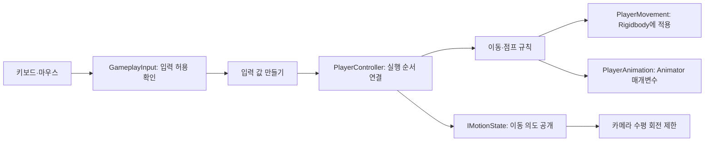

# 입력·이동·카메라·애니메이션 기술문서

문서 ID: `PD-02` · 기능 ID: `F01`~`F04` · 코드 확인일: 2026-10-14

이 문서는 현재 파일을 읽어 확인한 구현을 설명합니다. 문서 작성 과정에서는 게임 코드, 씬, 메타 파일을 변경하지 않았으며 새 플레이 검사를 실행하지 않았습니다. 아래의 검사 절차는 **앞으로 재검사할 방법**이며 이번 문서 작업의 실행 성공 기록이 아닙니다. 과거 작업 로그의 통과 기록도 현재 플레이 상태의 보증으로 바꾸어 해석하지 않습니다.

대상은 `Assets/02Scripts/01Player`의 Core·Input·Movement·Camera·Animation과 해당 도메인 규칙입니다. 씬에 저장된 값은 C# 파일에 적힌 기본값과 다를 수 있습니다. 아래 표에서 ‘기본값’은 **스크립트가 처음 생성될 때의 값**을 뜻하며 현재 씬 값을 단정하지 않습니다. 씬 연결표는 전체 문서의 적용 현황을 함께 보세요.

## 1. 먼저 이해할 구조

키보드는 ‘앞으로 가고 싶다’는 요청을 만듭니다. 이동 규칙은 걷기인지 달리기인지를 결정합니다. Unity의 Rigidbody는 실제 위치를 움직이고, Animator는 본의 자세를 바꿉니다. 카메라는 이 둘을 지켜보는 별도 기능입니다.

예를 들어 벽 앞에서 W를 누르면 ‘걷고 싶다’는 요청은 계속 있지만 충돌 때문에 실제 위치는 움직이지 않을 수 있습니다. 현재 `IsMoving`과 대기·걷기·달리기 선택은 **실제 속도가 아니라 입력 의도**를 사용합니다. 따라서 벽에 막혀도 걷기 모션이 나올 수 있고 카메라는 이동 중 회전 규칙을 사용할 수 있습니다. 이것은 현재 코드에서 확인되는 설계이며 ‘실제 이동 속도를 읽는다’고 설명하면 틀립니다.



용어를 쉬운 말로 바꾸면 다음과 같습니다.

| 용어 | 뜻 | 이 프로젝트의 예 |
| --- | --- | --- |
| 정책·규칙 | 무엇을 할지 결정하는 계산 | 조준 중에는 달리기 요청을 끄기 |
| 연결부 | 규칙의 결과를 Unity 기능으로 실행하는 코드 | Rigidbody 속도를 쓰는 `PlayerMovement` |
| 인터페이스 | 서로 주고받을 내용만 적은 작은 약속 | `IMotionState`의 `IsMoving` 하나 |
| 상태 | 지금 어느 단계인지 나타내는 이름 | Ready → Anticipation → Airborne → Landing |
| 프레임 | 화면이나 물리를 한 번 갱신하는 단위 | `Update`는 화면 갱신, `FixedUpdate`는 일정한 물리 간격 |
| 직렬화 값 | Unity가 씬·프리팹에 저장해 둔 값 | Inspector의 걷기 속도 |
| 혼합·블렌드 | 한 자세에서 다른 자세로 조금씩 바꾸기 | 점프 착지에서 걷기로 0.15초 동안 전환 |

## 2. 파일별 책임과 추적표

이 표의 링크는 문서가 프로젝트의 `PlayerDocumentation` 폴더에 있을 때를 기준으로 합니다. 줄 번호는 확인일의 파일 기준이며 이후 편집하면 달라질 수 있습니다. 줄 번호와 함수 이름을 함께 이용하세요.

| 기능 | 파일 | 주요 형식·함수와 줄 | 맡은 일 | 직접 하지 않는 일 |
| --- | --- | --- | --- | --- |
| 공통 | [Core/PlayerController.cs](../Assets/02Scripts/01Player/Core/PlayerController.cs) | `EnsureRuntimeServices` 50, `Update` 63, `FixedUpdate` 82 | 입력·이동·점프·Animator 서비스를 연결하고 실행 | 접지 검사 세부 계산, 키별 명령 결정 |
| F01 | [Input/PlayerInput.cs](../Assets/02Scripts/01Player/Input/PlayerInput.cs) | `PlayerInputFrame` 5, `IPlayerInputSource` 25, `KeyboardInput.Read` 36 | WASD·Shift·Space를 이동 요청 값으로 바꿈 | Rigidbody 이동 |
| F01 | [Input/GameplayInput.cs](../Assets/02Scripts/01Player/Input/GameplayInput.cs) | `StateAllowsGameplay` 12, `SetBlocked` 29 | 게임 상태·메뉴·포커스·커서 조건을 합침 | 커서 잠금 값을 직접 쓰기 |
| F01 | [Domain/InputPermission.cs](../Assets/02Scripts/01Player/Domain/InputPermission.cs) | `AllowsGameplay` 8, `SetBlocked` 11 | 여러 메뉴의 차단 요청 보관 | Unity 메뉴 객체 찾기 |
| F01 | [Input/CombatInput.cs](../Assets/02Scripts/01Player/Input/CombatInput.cs) | `InputActivationGate` 25, `CombatInput.Read` 59 | 우클릭 유지·좌클릭 새 누름 읽기, 재활성화 첫 클릭 제외 | 산탄·명중 계산 |
| F01 | [Input/InteractionInput.cs](../Assets/02Scripts/01Player/Input/InteractionInput.cs) | `IInteractionInputSource` 4, `Read` 16 | 좌클릭 누름·유지, 숫자 1 누름을 손 명령으로 바꿈 | F 인벤토리 저장·덫 설치 구현 |
| F02 | [Domain/MovementPolicy.cs](../Assets/02Scripts/01Player/Domain/MovementPolicy.cs) | `MovementIntent` 2, `MovementSettings` 19, `MovementPolicy` 44 | 엔진 벡터 없이 이동 요청·설정·상태 결정 | 실제 충돌 처리 |
| F02 | [Movement/PlayerMovement.cs](../Assets/02Scripts/01Player/Movement/PlayerMovement.cs) | `Apply` 17, `GetDirection` 42 | 카메라 기준 방향·가속·회전·수직 속도를 Rigidbody에 적용 | 키보드 읽기, Animator 재생 |
| F02 | [Movement/StepSettings.cs](../Assets/02Scripts/01Player/Movement/StepSettings.cs) | `StepSettings` 5 | 턱 높이·거리·상승 속도·경사·레이어 설정 | 스스로 이동시키기 |
| F02 | [Movement/StepSolver.cs](../Assets/02Scripts/01Player/Movement/StepSolver.cs) | `IStepSolver` 3, `TryGetVerticalSpeed` 32 | 턱 위에 올라갈 공간과 높이를 확인해 상승 속도 제안 | Rigidbody 속도 직접 변경 |
| F03 | [Domain/IMotionState.cs](../Assets/02Scripts/01Player/Domain/IMotionState.cs) | `IMotionState` 2 | 이동 의도 여부 하나만 공개 | 플레이어 전체 구현 공개 |
| F03 | [Domain/OrbitPolicy.cs](../Assets/02Scripts/01Player/Domain/OrbitPolicy.cs) | `Evaluate` 28, `Reset` 50 | 이동 중 360도·정지 중 제한 각도 계산 | Cinemachine 객체 수정 |
| F03 | [Camera/CameraCursorLock.cs](../Assets/02Scripts/01Player/Camera/CameraCursorLock.cs) | `Update` 30, `RefreshPermission` 56, `SetLocked` 70 | 실제 커서 잠금·표시와 카메라 입력 활성화 | UI 버튼 동작 |
| F03 | [Camera/CameraOrbitLimit.cs](../Assets/02Scripts/01Player/Camera/CameraOrbitLimit.cs) | `Update` 37, `OnDisable` 52 | OrbitPolicy 결과를 Cinemachine 수평 축에 적용·복구 | 상하 회전 범위 변경 |
| F03 | [Camera/AimZoom.cs](../Assets/02Scripts/01Player/Camera/AimZoom.cs) | `Update` 34, `OnDisable` 45 | 조준 상태에 따라 Cinemachine 시야각 변경·복구 | 명중률·산탄 판정 |
| F04 | [Domain/JumpPolicy.cs](../Assets/02Scripts/01Player/Domain/JumpPolicy.cs) | `JumpFrame` 13, `JumpPolicy.Step` 63 | 준비·공중·착지 단계와 버퍼·클립 시간 선택 | 중력 직접 계산·위치 이동 |
| F04 | [Movement/PlayerJump.cs](../Assets/02Scripts/01Player/Movement/PlayerJump.cs) | `Settings` 8, `Step` 41, `HasSupport` 56 | 바닥 검사와 높이에 맞는 최초 상승 속도 계산 | Rigidbody에 직접 속도 쓰기 |
| F04 | [Animation/PlayerAnimation.cs](../Assets/02Scripts/01Player/Animation/PlayerAnimation.cs) | 생성자 28, `Apply` 54, `ApplyLegacyController` 71 | 이동·점프 값을 Animator에 전달 | 기본 모션의 본 곡선을 코드로 재작성 |
| F04 | [Animation/ShotgunPose.cs](../Assets/02Scripts/01Player/Animation/ShotgunPose.cs) | `Tick` 42, `Apply` 94, `ResetPose` 131 | 사격 자세의 Animator 값과 실제 조준 방향 보정 | 손 입력, 피해·적 체력 처리 |

추가로 읽은 연결 근거는 [CombatPolicy.cs](../Assets/02Scripts/01Player/Domain/CombatPolicy.cs)의 `IAimState`·`RestrictMovement`, [ShotgunEquipment.cs](../Assets/02Scripts/01Player/Equipment/ShotgunEquipment.cs)의 `LateUpdate`, [InteractionSettings.cs](../Assets/02Scripts/01Player/Editor/Setup/InteractionSettings.cs)의 무마찰 연결, [PlayerJump.controller](../Assets/04Prefabs/Player/Animations/PlayerJump.controller), [Shotgun_Fire.anim](../Assets/03Sprites/Player/Animations/Shotgun_Fire.anim), [CatCameraLook.inputactions](../Assets/02Scripts/01Player/Camera/CatCameraLook.inputactions)입니다. 장비·상호작용의 전체 동작은 해당 기능 문서에서 설명합니다.

## 3. F01 — 입력과 조작 권한

### 3.1 목적과 현재 규칙

메뉴를 조작하는 마우스 클릭이 물건 집기나 총 발사로 동시에 사용되지 않도록 합니다. ‘마우스가 보인다’와 ‘게임 조작이 가능하다’를 여러 스크립트가 제각각 결정하지 않게 공통 확인 경로를 둡니다.

`GameplayInput.IsEnabled`가 true이려면 다음 조건을 모두 만족해야 합니다.

1. GameManager가 없거나 상태가 `Playing` 또는 `RoundClear`여야 합니다.
2. 시간이 멈추지 않았어야 합니다. 기준은 `Time.timeScale > 0`입니다.
3. 열린 메뉴 등에서 등록한 차단 요청이 없어야 합니다.
4. Unity 게임 창이 포커스를 가지고 있어야 합니다.
5. 커서가 `Locked`여야 합니다.
6. 메뉴를 닫거나 잠금을 복구한 바로 그 프레임이 지나야 합니다.

따라서 결과 표시 전 `RoundClear` 구간은 공통 입력에서 허용합니다. 하지만 덫 설치처럼 더 좁은 상태 조건을 가진 기능은 따로 금지될 수 있습니다. 이 문서의 공통 허용과 모든 개별 기능의 허용을 같은 뜻으로 해석하지 않습니다. 근거: `GameplayInput.cs` 12~26행.

기본 이동 입력은 WASD이고 Shift는 달리기 요청, Space는 새로 눌렀을 때만 점프 요청입니다. `InteractionInput`은 좌클릭·숫자 1을 읽고, `CombatInput`은 좌클릭·우클릭을 읽습니다. 같은 버튼을 읽는다고 동시에 실행하는 것은 아닙니다. 장비·덫 선택·손 상태에 따른 실제 사용 결정은 각각의 상호작용/전투 연결부가 담당합니다.

### 3.2 실제 호출 순서

```text
메뉴 열기 → GameplayInput.SetBlocked(메뉴 자신, true)
  → InputPermission이 해당 메뉴를 차단 목록에 추가
  → PermissionChanged 이벤트
  → CameraCursorLock이 커서를 해제
  → 기본 입력 공급자들이 입력을 받지 않음

메뉴 닫기 → SetBlocked(같은 메뉴, false)
  → 다른 차단자가 없을 때만 조작 허용
  → 잠금 복구 프레임의 클릭/점프는 버림
  → 다음 정상 입력부터 게임 명령으로 사용
```

차단 목록은 `HashSet<object>`입니다. 여러 사람이 문을 잠가 놓았다고 생각하면 쉽습니다. A 메뉴가 자기 자물쇠를 제거해도 B 메뉴의 자물쇠는 남습니다. ‘메뉴 하나가 닫혔으므로 전부 입력 허용’처럼 다른 메뉴의 권한을 지우지 않습니다.

### 3.3 코드 읽기

출처: `Domain/InputPermission.cs` 8~14행.

```csharp
public bool AllowsGameplay(bool stateAllowsGameplay, bool timeRunning)
    => stateAllowsGameplay && timeRunning && blockers.Count == 0;

public bool SetBlocked(object owner, bool blocked)
{
    if (owner == null) return false;
    return blocked ? blockers.Add(owner) : blockers.Remove(owner);
}
```

- 첫 줄은 게임 상태와 시간 흐름을 받아 판단하겠다는 약속입니다.
- `&&`는 ‘그리고’입니다. 세 조건 중 하나라도 아니면 조작을 막습니다.
- `owner`는 ‘누가 막았는지’를 나타내는 표입니다. 보통 메뉴 컴포넌트 자신을 넘깁니다.
- 주인이 없으면 등록하지 않습니다. 닫을 때 누구의 요청을 해제할지 알 수 없기 때문입니다.
- `blocked`가 true이면 추가하고 false이면 그 주인의 요청만 제거합니다.

출처: `Input/CombatInput.cs` 30~41행 중 핵심 부분.

```csharp
if (!enabled)
{
    Reset();
    return false;
}
if (!wasEnabled) enabledSinceFrame = frame;
wasEnabled = true;
return frame > enabledSinceFrame;
```

- 입력이 꺼져 있으면 이전 상태를 비웁니다.
- 처음 켜진 프레임 번호를 기억합니다.
- 그 프레임보다 뒤에서만 새 클릭을 허용합니다.
- 같은 프레임에 여러 번 읽더라도 잠금 복구용 클릭이 두 번째 읽기에서 발사로 바뀌지 않습니다.

출처: `Input/PlayerInput.cs` 18~21행.

```csharp
Vector2 limited = Vector2.ClampMagnitude(move, 1);
Intent = new MovementIntent(limited.x, limited.y, sprint);
JumpPressed = jumpPressed && !inputBlocked;
InputBlocked = inputBlocked;
```

- 대각선 W+D를 누를 때 벡터 길이가 1보다 커지지 않게 자릅니다. 대각선만 더 빨라지는 문제를 막습니다.
- 엔진 벡터를 순수한 숫자 두 개와 달리기 여부로 바꿉니다.
- 입력 차단 중에는 점프 요청을 보존하지 않습니다.
- ‘아무 키도 안 누름’과 ‘메뉴 때문에 입력을 못 받음’을 별도로 기록합니다.

### 3.4 수정 위치와 경계조건

- 키를 바꾸려면 `KeyboardInput.Read`, `CombatInput.Read`, `InteractionInput.Read` 중 해당 기능의 입력 부분을 봅니다. 카메라 Look은 별도 Input Action을 사용합니다.
- 게임패드나 자동 검사용 입력은 `IPlayerInputSource.Read()`를 구현해 `PlayerController.SetInputSource(...)`로 연결할 수 있습니다. `null`은 기본 키보드로 복귀합니다.
- **대체 입력 공급자도 메뉴·기절 등 차단 조건을 책임져야 합니다.** PlayerController는 기본 입력과 다른 모든 공급자에 전역 차단을 강제로 덧씌우지 않습니다. 테스트 입력은 의도적으로 기본 장치를 우회할 수 있습니다.
- UI가 차단을 등록하고 해제하지 않으면 게임 입력이 계속 막힐 수 있습니다. 닫기뿐 아니라 비활성화·파괴 경로에서도 동일한 owner로 해제하는지 확인합니다.
- `GameplayInput`은 Unity와 GameManager에 연결된 정적 코드입니다. InputPermission까지 Unity 독립적인 것은 맞지만 전체 입력 계층을 그대로 다른 엔진에 복사할 수 있다는 뜻은 아닙니다.

### 3.5 검증 방법과 SOLID 검토

| 검사 | 실행할 일 | 기대 결과 |
| --- | --- | --- |
| 메뉴 중 오작동 | ESC로 설정창을 열고 버튼/슬라이더 클릭 | 커서가 보이고 물건 집기·발사·점프가 발생하지 않음 |
| 복귀 클릭 소비 | 잠금이 풀린 상태에서 게임 화면을 클릭 | 잠금 복구에 사용한 클릭으로 총이 발사되지 않음 |
| 다중 차단 | 두 UI가 차단한 뒤 하나만 닫음 | 나머지 UI가 열린 동안 입력 차단 유지 |
| 창 포커스 | 키를 누르다 Alt+Tab 후 복귀 | 이전 점프 예약·손 입력이 임의로 이어지지 않음 |
| 대각선 속도 | 평지에서 W와 W+D의 이동 거리 비교 | 같은 시간에 대각선만 빨라지지 않음 |

좋은 점: 권한 계산과 실제 Cursor 제어가 나뉘어 있고, 필요한 입력만 `Reset()` 계약을 구현합니다. 이는 단일 책임(SRP)과 작은 인터페이스(ISP)에 맞습니다. 입력 공급자를 바꿀 수 있어 기존 이동 계산을 고치지 않고 확장할 수 있습니다(OCP).

현재 제한: `InputActivationGate`와 공통 초기화 인터페이스가 이름상 전투 전용처럼 보이는 `CombatInput.cs` 안에 함께 있습니다. 이동·상호작용도 사용하는 코드이므로 파일명만으로 찾기 쉽지 않습니다. 이것은 가독성 개선 후보이며 이번 문서 작업에서 파일을 나누거나 이름을 바꾸지 않았습니다. 또한 전역 정적 입력 경로는 로컬 1인 플레이에 맞춰져 있어 서로 독립적인 다중 플레이어 입력을 그대로 지원한다고 보장할 수 없습니다.

## 4. F02 — 이동, 작은 턱 넘기, 무마찰

### 4.1 목적과 현재 흐름

카메라를 돌린 뒤 W를 누르면 카메라가 보는 지면 방향으로 이동합니다. 걷기와 달리기 속도로 즉시 튀지 않고 현재 수평 속도에서 목표 속도로 가까워집니다. 낮은 턱은 넘을 수 있는 높이와 머리 위 공간을 확인한 뒤 조금씩 올라갑니다.

`PlayerController.Update`가 입력을 읽고 `FixedUpdate`가 실제 물리에 적용합니다. 화면 갱신과 물리 갱신의 횟수가 다를 수 있으므로 Space 누름은 `pendingJump`에 잠시 보관해 다음 물리 갱신에서 한 번만 사용합니다. 이 짧은 전달 보관과 뒤에서 설명할 ‘착지 전 0.15초 점프 버퍼’는 목적이 다른 두 단계입니다.

```text
PlayerController.FixedUpdate
  → 이동 설정 묶음 만들기
  → PlayerJump.Step으로 점프 상태 확인
  → PlayerMovement.Apply
      → 카메라 전방을 지면에 눕혀 이동 방향 만들기
      → MovementPolicy로 걷기/달리기 속도 선택
      → 가속 제한 안에서 수평 속도 변경
      → 점프면 이륙 속도, 아니면 StepSolver의 턱 상승 결과 사용
      → Rigidbody.linearVelocity와 MoveRotation에 적용
```

### 4.2 코드 읽기

출처: `Movement/PlayerMovement.cs` 19~34행 중 이동 부분.

```csharp
Vector3 direction = GetDirection(new Vector2(intent.Horizontal, intent.Forward), view);
Vector3 target = direction * MovementPolicy.SelectSpeed(intent, settings);
Vector3 velocity = body.linearVelocity;
Vector3 horizontal = Vector3.MoveTowards(
    new Vector3(velocity.x, 0, velocity.z), target, settings.Acceleration * deltaTime);
```

- 첫 줄은 ‘W’라는 키 의미를 카메라 기준 실제 지면 방향으로 바꿉니다.
- 둘째 줄은 방향에 걷기·달리기 속도를 곱해 목표 속도를 만듭니다.
- 셋째 줄은 현재 물리 속도를 읽습니다.
- 마지막 두 줄은 수평 속도만 목표에 가깝게 바꿉니다. 위아래 속도를 0으로 만들지 않기 때문에 중력·점프를 별도로 유지할 수 있습니다.

같은 파일 25~34행의 수직 처리입니다.

```csharp
float vertical = velocity.y;
if (jump.Active)
{
    steps.Reset();
    if (jump.TakeOff) vertical = launchSpeed;
}
else if (steps.TryGetVerticalSpeed(horizontal, direction, deltaTime, out float stepSpeed))
    vertical = stepSpeed;
body.linearVelocity = new Vector3(horizontal.x, vertical, horizontal.z);
```

- 현재 수직 속도를 먼저 보존합니다.
- 점프 단계가 진행 중이면 남은 턱 상승 목표를 취소합니다.
- 이륙하는 딱 한 번에만 최초 상승 속도를 넣습니다. 계속 위로 떠오르는 힘을 매 프레임 넣지 않습니다.
- 점프 중이 아닐 때만 턱 계산에 수직 속도 보정을 맡깁니다.
- 계산된 수평·수직 값을 한 곳에서 Rigidbody에 씁니다. 서로 다른 기능이 같은 속도를 덮어쓰는 일을 줄입니다.

### 4.3 작은 턱을 넘는 검사 순서

`StepSolver.TryGetVerticalSpeed`는 다음을 확인합니다.

1. 턱 기능이 켜져 있고 입력과 수평 속도가 있는지 봅니다. 현재 지원 형태는 세로 CapsuleCollider(`direction == 1`)입니다.
2. 캐릭터 발 아래에 실제로 설 수 있는 면이 있는지 확인합니다. 빠르게 상승·낙하 중이면 새 턱 넘기를 시작하지 않습니다.
3. 발 앞에 낮은 장애물이 있는지 먼저 검사합니다. 없으면 더 비싼 공간 검사는 하지 않습니다.
4. 장애물 뒤쪽 윗면을 내려다보며 높이와 경사를 확인합니다.
5. 위로 올라갈 공간, 앞으로 갈 공간, 최종 도착 위치의 몸 공간을 검사합니다.
6. 통과하면 목표 발 높이를 저장하고 최대 상승 속도 안에서 조금씩 올립니다.
7. 방향을 크게 바꾸거나 제한 시간이 지나거나 머리 위가 막히면 상승을 중단합니다.

높이만 낮다고 무조건 벽을 통과시키는 방식이 아닙니다. 턱 위의 공간까지 확인합니다. 검사 배열은 24개씩 재사용합니다. 결과가 배열을 가득 채울 만큼 복잡한 곳에서는 누락 위험 때문에 검사를 실패로 처리합니다. 이는 안전한 거부 방식이지만, 충돌체가 매우 많은 지점에서는 넘을 수 있어 보이는 턱도 거절될 수 있다는 한계가 있습니다. 근거: `StepSolver.cs` 35~106, 131~162행.

### 4.4 마찰은 스크립트의 가짜 물리가 아님

[Player_NoFriction.physicMaterial](../Assets/04Prefabs/Player/Physics/Player_NoFriction.physicMaterial)에는 정지 마찰 0, 움직이는 중의 마찰 0이 저장되어 있습니다. [InteractionSettings.cs](../Assets/02Scripts/01Player/Editor/Setup/InteractionSettings.cs) 19~31행은 기존 물리 재질이 `Multiply` 조합인지 확인하고 플레이어 Rigidbody에 속한 비 Trigger 충돌체에 연결합니다. Rigidbody의 `linearDamping`도 0으로 연결합니다.

마찰 0과 이동 감속은 다릅니다. 바닥이 붙잡는 힘은 줄여도, `PlayerMovement`는 키를 떼면 목표 수평 속도 0으로 가까워지도록 계산합니다. 따라서 무마찰이라고 얼음 위처럼 끝없이 미끄러져야 하는 것은 아닙니다. 상대 충돌체의 재질 조합 방식도 최종 접촉 마찰에 영향을 줄 수 있으므로, 실제 씬에서는 양쪽 재질을 같이 확인해야 합니다.

### 4.5 Inspector에서 조절하는 법

대상 Player의 `PlayerController`를 선택하고 다음 필드를 확인합니다.

| 항목 | 코드 기본값 | 바꾸면 달라지는 점 |
| --- | --- | --- |
| `view` | 미지정 | 이동의 방향 기준. 비우면 월드 전방 사용 |
| `walkSpeed` / `runSpeed` | 1.6 / 3.4 | 초당 이동할 월드 거리 |
| `acceleration` | 18 | 속도가 목표에 따라붙는 빠르기. 작으면 출발·정지가 느림 |
| `turnSpeed` | 720 | 1초에 돌 수 있는 최대 각도 |
| `steps.maxHeight` | 0.28 | 넘을 최대 턱 높이. 0이면 끔 |
| `steps.forwardReach` | 0.12 | 몸 앞에서 추가로 검사하는 거리 |
| `steps.riseSpeed` | 1.8 | 턱을 오르는 최대 수직 속도 |
| `steps.maxLandingSlope` | 45도 | 턱 윗면으로 인정할 경사 한계 |
| `steps.solidLayers` | DefaultRaycastLayers | 지형 검사에 포함할 레이어 |

`aimSource`가 활성화된 `IAimState`를 제공하면 조준 중 Shift 요청을 지워 걷게 합니다. 멈춰 있으면 대기입니다. 조준한다고 입력 없이 앞으로 이동시키지 않습니다. 조준/사격에서 카메라 쪽으로 몸을 돌릴지도 `WantsCameraFacing`으로 별도 받습니다.

### 4.6 경계조건, 검사, SOLID 검토

- CapsuleCollider의 축·크기·부모 스케일과 Rigidbody 설정은 물리 검사의 전제입니다. 코드 기본값만 바꿔 모든 모델 비율을 자동 지원한다고 볼 수 없습니다.
- `PlayerController.ResetRuntimeState()`는 입력·점프·턱 목표·애니메이션 캐시를 비웁니다. 플레이어 위치나 수평 속도를 임의로 원점/0으로 바꾸는 리스폰 함수는 아닙니다.
- 이동 중 벽을 향해 계속 누르면 ‘이동 의도’가 남습니다. 실제 정지 여부에 따라 모션·카메라를 바꾸려면 별도 요구사항과 검증이 필요합니다.

검사 순서는 평지 걷기 → 달리기 → 대각선 → 키 해제 감속 → 낮은 턱 → 최대 높이보다 높은 턱 → 머리 위가 낮은 턱 → 점프 도중 턱 접근입니다. 실제 지면 위치와 Rigidbody 속도를 함께 봅니다. `Tools > Cat Player > Play 모드 이동·턱·카메라 검증`은 기존 수동 검증 메뉴입니다. 해당 도구는 런타임 입력과 위치를 일시 조절하므로 작업 중 직접 조작과 동시에 실행하지 않습니다.

좋은 점: 지형 검사는 `IStepSolver`, 실제 물리 쓰기는 `PlayerMovement`, 실행 순서는 `PlayerController`로 나뉩니다(SRP). 다른 턱 검사기를 연결할 수 있어 구현 교체 지점도 분명합니다(DIP/OCP). 다만 `IStepSolver`의 계약 자체는 `Vector3`를 사용하므로 엔진 독립 인터페이스가 아닙니다. `MovementPolicy`는 엔진을 바꾸어도 옮기기 쉽지만 물리·좌표 연결부는 교체해야 합니다.

## 5. F03 — 3인칭 카메라, 커서, 조준 확대

### 5.1 카메라와 커서의 역할 구분

CinemachineCamera는 카메라 구도를 계산하고 Main Camera의 CinemachineBrain이 화면에 그 결과를 출력하는 구조입니다. 따라서 Main Camera를 손으로 회전시켜도 실행 중 Brain의 결과로 바뀔 수 있습니다. 구도는 실제로 연결된 Cinemachine의 Follow 대상·궤도·렌즈에서 조절해야 합니다. 이 문서 작업에서는 현재 씬의 모든 Transform 수치를 새로 측정하지 않았습니다.

[CatCameraLook.inputactions](../Assets/02Scripts/01Player/Camera/CatCameraLook.inputactions)에는 `Camera/Look`이라는 Vector2 입력에 `<Mouse>/delta`가 연결되어 있습니다. 마우스의 ‘화면 위치’가 아니라 **이번 프레임에 움직인 양**을 읽습니다. 화면 중앙 포인터의 위치와 이 Look 입력은 다른 기능입니다.

| 담당 | 조절 대상 | 조절하지 않는 대상 |
| --- | --- | --- |
| CameraCursorLock | Cursor 잠금·표시, Cinemachine 입력 켜기/끄기 | 카메라 거리·줌 |
| CameraOrbitLimit | 수평 회전 범위 | 수직 각도·시야각 |
| AimZoom | 시야각(FOV) | 실제 캐릭터 스케일·산탄 계산 |

### 5.2 정지 중 좌우 60도 제한

`CameraOrbitLimit.motionSource`에는 `IMotionState`를 구현한 PlayerController를 연결합니다. 이동 의도가 있으면 수평 축 범위를 -180~180도로 하고 끝에서 반대편으로 이어 돌 수 있게 합니다. 멈추는 순간의 방향을 기억하고 그 기준에서 좌우 `stationaryHalfAngle`만 허용합니다. 기본값은 각각 60도입니다.

출처: `OrbitPolicy.cs` 37~47행.

```csharp
if (!initialized || wasMoving)
    stationaryCenter = Normalize(currentYaw);
initialized = true;
wasMoving = false;
float halfAngle = Math.Max(0f, Math.Min(180f, stationaryHalfAngle));
float offset = Normalize(currentYaw - stationaryCenter);
float value = stationaryCenter + Math.Max(-halfAngle, Math.Min(halfAngle, offset));
```

- 아직 기준이 없거나 방금까지 이동했다면 현재 카메라 방향을 새 기준으로 저장합니다.
- 이후 정지 중에는 기준을 계속 따라 움직이지 않도록 `wasMoving`을 false로 바꿉니다.
- 설정 범위를 0~180도로 제한합니다.
- 지금 각도와 기준의 차이를 -180~180도 범위로 정리합니다.
- 허용 범위 밖의 각도는 끝값에 붙입니다. 캐릭터가 멈출 때 보고 있던 방향이 중심입니다.

`CameraOrbitLimit.Update`는 실행 순서 100으로 일반 입력 Update 뒤에 적용합니다. 기본 자동 중앙복귀(Recentering)는 이 제한을 적용하는 동안 끕니다. 컴포넌트를 끄면 시작 때 저장한 범위·중심·반복 회전·중앙복귀 설정을 되돌립니다. 이것은 에셋 파일을 복원하는 것이 아니라 실행 중 변경한 Cinemachine 축 설정을 정리하는 동작입니다.

### 5.3 ESC 설정창에서 마우스가 사라지던 문제를 피하는 현재 구조

`CameraCursorLock`은 메뉴가 열려 있을 때의 잠금 요청을 거절합니다. 메뉴를 닫고 조작 권한이 다시 허용되면 잠금을 바로 같은 프레임에 쓰지 않고 예약합니다. ESC가 해제되고 요청 프레임 다음이 된 뒤에 잠급니다. Unity Editor도 ESC로 커서를 해제할 수 있기 때문에 같은 프레임에서 잠금·해제가 싸우지 않게 한 것입니다.

출처: `CameraCursorLock.cs` 45~49행.

```csharp
if (capturePending)
{
    if (!GameplayInput.CanCaptureCursor) capturePending = false;
    else if (Time.frameCount > captureRequestedFrame &&
             (keyboard == null || !keyboard.escapeKey.isPressed))
        SetLocked(true);
}
```

- 잠금을 예약해 두었을 때만 이 경로를 사용합니다.
- 그 사이 다시 메뉴가 열리거나 창 포커스를 잃으면 예약을 취소합니다.
- ESC를 아직 누르고 있거나 예약한 그 프레임이면 기다립니다.
- 조건이 맞을 때만 잠급니다. `SetLocked` 내부에서도 권한을 한 번 더 확인합니다.

이 코드만으로 UI 클릭 전체가 작동하는 것은 아닙니다. UI에는 정상 EventSystem과 UI 입력 모듈, Raycast 대상, 버튼 연결도 있어야 합니다. 커서가 보이는데도 버튼이 작동하지 않으면 그 연결을 별도로 확인해야 합니다. 반대로 메뉴 표시 코드는 실제 Cursor 값을 직접 쓰지 않고 `GameplayInput.SetBlocked`로 권한만 요청하는 것이 현재 역할 분리입니다.

### 5.4 우클릭 조준 확대

`AimZoom.aimSource`는 `IAimState.IsAiming`만 읽습니다. 켜질 때 기존 Cinemachine 시야각을 기억하고, 조준하면 설정 시야각으로 좁히며, 해제하면 원래 값으로 돌아갑니다. 기본 조준 시야각은 40도, 전환 시간은 0.16초입니다. 기본 시야각이 이미 40도보다 좁다면 줌 때문에 더 넓어지지 않습니다.

출처: `AimZoom.cs` 37~42행.

```csharp
float target = aiming
    ? Mathf.Min(originalFieldOfView, Mathf.Clamp(aimedFieldOfView, 1f, 179f))
    : originalFieldOfView;
float next = transitionSeconds <= 0f ? target : Mathf.SmoothDamp(
    virtualCamera.Lens.FieldOfView, target, ref zoomVelocity,
    transitionSeconds, Mathf.Infinity, Time.unscaledDeltaTime);
virtualCamera.Lens.FieldOfView = next;
```

- 조준 중이면 원래보다 같거나 좁은 시야각을 고릅니다.
- 조준하지 않으면 처음 기억한 시야각을 고릅니다.
- 전환 시간이 0이면 즉시 바꾸고, 아니면 조금씩 부드럽게 따라갑니다.
- `unscaledDeltaTime`은 게임 시간 배율에 영향을 받지 않는 시간입니다. 메뉴 등으로 게임 시간이 멈출 때의 시각적 복귀와 관련됩니다.
- Main Camera에 직접 쓰지 않고 Cinemachine 렌즈에 결과를 씁니다.

### 5.5 수정법·검사·설계 리뷰

Inspector에서 구도는 Cinemachine의 Follow/Orbit 설정, 수평 제한은 `CameraOrbitLimit.stationaryHalfAngle`, 확대는 `AimZoom.aimedFieldOfView`와 `transitionSeconds`를 수정합니다. 포인터 위치를 움직여 카메라 구도 문제를 숨기지 않습니다. 현재 공통 설정 적용 분리 기록에서는 마우스 감도 UI 값을 카메라에 새로 연결하는 일은 별도 범위였습니다. 해당 슬라이더가 존재한다는 이유만으로 감도 연결까지 완료되었다고 단정하지 않습니다.

검사는 다음처럼 구분합니다.

- 이동 중 수평으로 한 바퀴 회전한 뒤 멈춰 좌우 끝을 확인합니다.
- 다른 방향을 본 상태에서 다시 이동→정지하여 새 기준이 정지 순간으로 바뀌는지 봅니다.
- 위아래 회전은 기존 수직 범위를 유지하는지 봅니다.
- ESC 열기→버튼 클릭/드래그→ESC 닫기 후 잠금 복구를 확인합니다.
- Alt+Tab으로 포커스를 잃었을 때 잠금이 강제로 되살아나지 않는지 봅니다.
- 조준 줌·해제·장비 해제를 반복하고 Main Camera의 실제 화면이 자연스럽게 복귀하는지 봅니다.

좋은 점: `OrbitPolicy`에는 Unity 코드가 없고, 카메라는 전체 플레이어 구현이 아니라 `IMotionState`·`IAimState`라는 작은 계약을 읽습니다(DIP/ISP). 커서 쓰기도 한 컴포넌트로 모았습니다(SRP). 현재 제한: `motionSource`·`aimSource`는 Inspector 연결을 위해 MonoBehaviour로 저장한 뒤 실행 중 인터페이스를 확인합니다. 잘못된 종류의 컴포넌트를 넣으면 자동으로 올바른 대상을 찾아 주지 않습니다. 연결 검사가 필요합니다. Cinemachine 전용 축·렌즈 코드는 다른 엔진에서 그대로 사용할 수 없습니다.

## 6. F04 — Animator, 점프 모션, 사격 자세와의 연결

### 6.1 실제 이동과 모양 변형의 분리

이동·점프에는 두 가지 변화가 있습니다.

1. 캐릭터 전체가 바닥 위에서 이동하고 실제로 떠오르는 변화: Rigidbody가 담당합니다.
2. 몸이 눌리고 늘어나며 손·귀·꼬리의 자세가 바뀌는 변화: Animator가 클립의 본 곡선을 읽고, 스키닝된 메시가 본을 따라 변형됩니다.

`PlayerAnimation` 생성자는 `animator.applyRootMotion = false`로 설정합니다. 모션의 루트 이동을 다시 캐릭터 위치에 더해 물리 이동과 중복시키지 않기 위한 구성입니다. 사격할 때 총과 양손은 Animator 평가 뒤 장비 자세 보정을 추가로 받을 수 있습니다. ‘본만 움직이고 메시 외형은 고정’인 구조가 아닙니다. 본의 변형이 스키닝된 메시의 모양을 바꿉니다. 다만 이 문서의 C# 검토만으로 모든 메시의 스킨 가중치 품질을 재검증했다고 주장하지 않습니다.

### 6.2 이동·점프 상태 그래프

현재 읽은 [PlayerJump.controller](../Assets/04Prefabs/Player/Animations/PlayerJump.controller)는 Base Layer에 Idle·Walk·Run·Jump가 있고 Shotgun 레이어에 Ready·Fire가 있습니다.

| 매개변수 | 타입 | 값의 의미 | 값을 보내는 코드 |
| --- | --- | --- | --- |
| `Movement` | Int | 0 대기 / 1 걷기 / 2 달리기 | PlayerAnimation.Apply |
| `JumpActive` | Bool | 점프의 준비·공중·착지 단계 진행 중 | PlayerAnimation.Apply |
| `JumpTime` | Float | 정책의 2초 기준 자세 시간을 0~1로 바꿔 클립 위치 지정 | PlayerAnimation.Apply |
| `ShotActive` | Bool | 발사 클립 진행 여부 | ShotgunPose.Tick |
| `ShotTime` | Float | 발사 클립의 현재 자세 위치 0~1 | ShotgunPose.Tick |

점프 진입은 `Any State → Jump` 공통 화살표 하나입니다. 이것이 Idle·Walk·Run에서 모두 점프로 들어가는 경로입니다. 각 상태에서 Jump로 따로 선이 세 개 보이지 않는다고 역방향 연결이 없는 것은 아닙니다. Jump가 끝나면 `Movement`에 따라 대기·걷기·달리기로 돌아갑니다. 현재 컨트롤러 파일의 고정 전환 시간은 점프 진입 0.08초, 점프 복귀 0.15초, 지상 이동 상태 사이 0.12초입니다. 근거: Controller 23, 48, 105, 161, 189, 272, 390, 505, 558, 586행.

출처: `PlayerAnimation.cs` 58~64행.

```csharp
animator.SetInteger(Movement, (int)MovementPolicy.SelectAnimation(intent));
animator.SetBool(JumpActive, jumpFrame.Active && SupportsJump);
if (SupportsJump && jumpFrame.Active)
    animator.SetFloat(jumpTime, Mathf.Clamp01(jumpFrame.PoseTime / 2f));
```

- 현재 입력 의도를 숫자 0·1·2로 바꿔 Animator에 줍니다.
- 점프 연결이 준비되어 있고 점프가 진행 중일 때만 JumpActive를 켭니다.
- 정책의 자세 위치를 기준값 2로 나눠 0~1로 바꿉니다. 실제 `Jump.anim`의 저장된 `m_StopTime`은 1.2초이므로, 이 2를 실제 클립 길이라고 설명하면 안 됩니다. 정규화된 비율로 현재 클립의 자세를 선택합니다.
- **점프 종료 직후에는 JumpTime을 0으로 다시 쓰지 않습니다.** 복귀 혼합 동안 나가는 Jump 자세도 아직 사용되므로, 0으로 되돌리면 마지막 착지 자세가 갑자기 점프 준비 자세로 되감길 수 있기 때문입니다.

`SupportsJump`는 이름만 보고 true가 되지 않습니다. Movement(Int)·JumpActive(Bool)·JumpTime(Float) 매개변수와 Base Layer의 Jump 상태가 있어야 합니다. 설정 `jumpSettings.enabled`도 켜져야 물리 점프가 활성화됩니다.

### 6.3 점프 단계와 버퍼

| 단계 | 쉬운 설명 | 다음 단계 조건 |
| --- | --- | --- |
| Ready | 일반 대기·걷기·달리기 | 바닥 위에서 새 Space 또는 유효한 보관 입력 |
| Anticipation | 뛰기 전에 몸을 누르는 준비 | 일반 준비 0.40초가 지나면 한 번 이륙 |
| Airborne | 실제로 떠오르고 내려오는 중 | 바닥 지지, 수직 속도, 최소 공중 시간 조건 만족 |
| Landing | 착지 충격과 회복 | 이동 중에는 짧은 회복, 정지 중에는 나머지 착지 자세 |

코드의 `TakeoffTime=.40`, `ApexTime=.855`, `TouchdownTime=1.31`, `ClipEnd=2`는 정책의 가상 시간표입니다. `PlayerAnimation`은 이 값을 2로 나눈 비율을 현재 1.2초 클립에 전달합니다. 공중을 무조건 2초 동안 날게 만드는 상수가 아닙니다. 공중 자세는 실제 수직 속도로 고르며, 높이·중력에 따라 실제 체공 시간이 달라집니다. 오래 떨어지는 동안은 착지 직전 자세 범위에 머뭅니다. 일반 절벽 낙하를 별도의 새 낙하 상태로 처리하는 기능은 이 정책에 추가되어 있지 않습니다.

`PlayerJump`가 계산하는 최초 상승 속도는 다음과 같습니다. 출처: `PlayerJump.cs` 50~53행.

```csharp
LaunchSpeed = Mathf.Sqrt(2f * Mathf.Max(0.05f, settings.height) * -Physics.gravity.y);
IsGrounded = HasSupport() && body.linearVelocity.y <= 0.2f;
return policy.Step(pressed, IsGrounded, body.linearVelocity.y, deltaTime, LaunchSpeed,
    Mathf.Max(0f, settings.jumpBufferSeconds), inputEnabled, moving);
```

- 원하는 높이와 Unity 중력으로 출발 속도를 구합니다. 이후의 중력은 Unity가 처리합니다.
- 발 아래 지지면이 있어도 아직 빠르게 올라가는 중이면 착지로 인정하지 않습니다.
- ‘키를 눌렀는지, 바닥인지, 수직 속도는 얼마인지’라는 관측값을 정책에 전달합니다.
- 정책은 올라갈지·착지할지 판단할 뿐 이 함수에서 Rigidbody 속도를 직접 쓰지는 않습니다.

기본 `jumpBufferSeconds`는 0.15초입니다. 착지 직전에 Space를 너무 일찍 눌러도 그 요청을 잠깐 기억하고 바닥에 닿았을 때 사용할 수 있습니다. 길게 누르는 자동 연속 점프나 공중 추가 점프를 뜻하지 않습니다. 버퍼가 만료되면 요청은 사라집니다. 메뉴·포커스 차단·입력 공급자 변경 시 아직 사용하지 않은 요청은 취소합니다.

착지 직후 0.13초 안의 압축 자세에서 다음 점프가 예약되면, 준비 시간을 이미 진행한 것으로 보고 착지 자세를 거꾸로 이어 이륙합니다. 이동 중 착지 회복은 기본 정책상 0.18초 뒤 지상 모션으로 일찍 돌아갈 수 있습니다. 이미 몸이 많이 펴진 뒤 새 점프를 누른 경우까지 무조건 압축 자세로 되돌리지는 않습니다. 이 세부 분기는 `JumpPolicy.Step` 113~139행, `BeginAnticipation` 179~186행, `PreparationPoseTime` 189~196행에 있습니다.

### 6.4 사격 후 모션 정지를 막는 현재 연결

`ShotgunPose`는 본 애니메이션 전체를 멈추는 대신 Shotgun 레이어의 `ShotActive`·`ShotTime`만 제어합니다. 현재 Controller의 Ready와 Fire는 모두 발사 클립을 연결하고 `Write Defaults`가 false입니다. Ready의 Speed는 0이며 Fire는 ShotTime 매개변수로 클립 위치를 제어합니다. 읽은 발사 클립의 바인딩은 `raiseWeight`·`recoilDistance`·`recoilPitch`라는 ShotgunPose의 숫자 세 종류입니다. 현재 파일에서 확인한 구성은 Controller 204~218, 433~452행 및 발사 클립 63~66, 120~123, 177~180행에 있습니다.

‘Ready가 비어 있어도 된다’며 임의로 Motion을 제거하거나, 사격 레이어에서 모든 본의 기본값을 강제로 덮어쓰는 설정을 추가하면 지상 모션과의 관계를 다시 검증해야 합니다. 이전 오류 수정 경위는 작업 로그를 근거로 추적하고, 여기서는 현재 파일 구성을 확인한 사실과 분리합니다.

발사 준비·판정·반동의 순서는 다음과 같습니다.

```text
전투 코드가 BeginShot 호출
  → Tick이 준비 시간을 진행
  → 준비 시각 fireMoment에 도달하면 ReadyToFire
  → 장비의 최신 총구 자세가 적용된 뒤 실제 발사 판정
  → AcknowledgeShot
  → 반동 구간 진행
  → 클립 끝에서 ShotActive 해제
```

판정 전에 반동만 먼저 진행되지 않도록 `SampleTime`은 판정 승인 전 `fireMoment`에서 멈춥니다(`ShotgunPose.cs` 68~69행). 기본 `fireMoment`와 `raiseSeconds`는 각각 0.12초이며 실제 씬 값과 클립 길이를 함께 맞춰야 합니다.

총은 조준점 쪽으로 향하도록 `ShotgunPose.Apply`가 보정하고, 양손은 `ShotgunEquipment.LateUpdate`에서 그립 위치를 따라갑니다. 다음 Update에서 이전 손 보정을 되돌린 뒤 Animator가 새 모션을 계산하므로 이전 프레임의 손 위치 보정이 계속 쌓이는 것을 피합니다. 총구가 너무 가까운 목표 때문에 뒤집히지 않게 앞쪽 보조 목표를 쓰는 분기도 있습니다. 이 자세 보정은 실제 총구 벽 판정을 대신하지 않습니다.

### 6.5 남아 있는 구형 컨트롤러 호환 경로

현재 코드에서 `CrossFadeInFixedTime`과 `AnimationClip.SampleAnimation`이 보인다고 모두 미사용 중복은 아닙니다.

- `PlayerAnimation.ApplyLegacyController`는 Movement·JumpActive 매개변수가 없는 구형 `Idle.controller`를 위한 대기·걷기·달리기 호환 경로입니다.
- `ShotgunPose.Tick`의 SampleAnimation 경로는 Shotgun 레이어·매개변수가 없는 컨트롤러에서만 사용됩니다.
- 새로운 PlayerJump.controller 경로에서는 Animator 상태 그래프와 매개변수를 사용합니다.
- `PlayerController.animationSettings`는 기존 씬 저장 정보와 구형 연결을 유지하려고 `HideInInspector`로 남아 있습니다. 새 컨트롤러의 일반 전환 시간을 이 숨은 값으로 바꾸는 것이 아닙니다.

다른 씬을 확인하지 않고 호환 코드를 삭제하면 공유 플레이어의 동작이 깨질 수 있습니다. 이번 문서 작업은 삭제하지 않습니다.

### 6.6 수정 위치와 확인 순서

| 수정 목표 | 수정할 곳 | 함께 확인할 곳 |
| --- | --- | --- |
| 실제 점프 높이 | PlayerController → Jump Settings → height(기본 0.45) | 머리 충돌·착지·총구 높이 |
| 미리 누른 점프 허용 시간 | jumpBufferSeconds(기본 0.15초) | 너무 이른 입력 만료, 메뉴 복귀 시 취소 |
| 바닥 경사 조건 | maxGroundAngle(기본 55도), groundLayers | 턱 설정의 경사 기준은 별도 기본 45도 |
| 눌림·손·귀·꼬리 자세 | Unity Animation 창의 Jump 클립 곡선 | 물리 높이를 곡선 루트 이동으로 중복 적용하지 않는지 |
| 대기/걷기/달리기 전환 | PlayerJump.controller의 Base Layer 전환 | Movement 값 0·1·2와 JumpActive 조건 |
| 점프 진입/복귀 부드러움 | Any State → Jump 및 Jump 복귀 전환 | JumpTime 유지, 실제 본 이동의 끊김 |
| 발사 자세·반동 | Shotgun_Fire 클립의 세 필드 | ShotgunPose.fireMoment와 판정 시각 |
| 조준 손 높이 | ShotgunPose.aimedLocalPosition, 장비 그립 | 모델 로컬 축, muzzle, 양손 본 연결 |

이 설정을 바꿀 때는 먼저 해당 에셋이 다른 씬/프리팹과 공유되는지 확인합니다. 본 이름이나 `raiseWeight` 등의 필드명을 바꾸면 클립의 연결 경로도 달라질 수 있습니다. 파일 이름 변경과 `.meta` 재발급을 해결책으로 사용하지 않습니다.

점프 검사표는 다음과 같습니다. 상태 이름만 확인하지 말고 실제 몸·발·꼬리의 변화를 함께 봅니다.

| 검사 | 기대 결과 |
| --- | --- |
| 대기 → 점프 → 대기 | 눌림·상승·착지·복귀가 순서대로 이어짐 |
| 걷기/달리기 → 점프 → 같은 이동 | 공중 수평 이동을 유지하고 착지 후 이동으로 자연스럽게 복귀 |
| 착지 직전 Space 새 누름 | 버퍼 범위 안이면 한 번 재점프, 오래 전 입력이면 취소 |
| Space를 계속 유지 | 유지 자체만으로 자동 연속 점프하지 않음 |
| 점프 준비 중 바닥 이탈 | 공중에서 뒤늦게 새 상승 속도를 만들어 내지 않음 |
| 이동 중 발사 → 계속 이동 | 몸·발·꼬리 모션이 멈추지 않음 |
| 점프 중 발사와 줌 | 점프 시간·사격 시간·총구 자세가 서로 끊기지 않음 |
| 착지 직전 메뉴 열기 | 보관 입력으로 메뉴 복귀 직후 원치 않는 점프가 발생하지 않음 |

### 6.7 SOLID 코드리뷰와 현재 제한

좋은 점은 실제 위치 이동, 접지 관측, 점프 단계 판단, Animator 전달이 분리되어 있다는 것입니다. 이 때문에 중력 오류는 물리 연결에서, 모션이 되감기는 오류는 JumpTime 전달에서 좁혀 볼 수 있습니다(SRP). 카메라·조준 연결도 작은 상태 계약을 사용합니다(ISP/DIP).

반면 JumpPolicy는 2초 기준의 고정된 자세 시간표를 쓰고, 실제 연결된 Jump.anim의 저장 길이는 1.2초입니다. PlayerAnimation이 `/ 2f`로 정규화하므로 이 두 숫자가 다르다는 사실만으로 재생 오류를 단정할 수는 없습니다. 다만 클립을 다른 구성으로 교체하면 실제 눌림·이륙·정점·착지 자세가 시간표의 비율과 맞는지 함께 확인해야 합니다. 새 클립을 Inspector에 넣는 것만으로 모든 비율이 자동 맞는 범용 시스템은 아닙니다. 여러 캐릭터로 확장할 때 시간표를 설정 데이터로 분리하는 방안을 고려할 수 있지만 **현재 구현된 기능은 아닙니다**.

`PlayerAnimation`은 만들 때 컨트롤러의 지원 여부를 계산합니다. `ShotgunPose`처럼 매번 컨트롤러 변경을 감지해 다시 묶지는 않습니다. 실행 중 Animator Controller를 교체하는 기능을 새로 만들면 재연결을 설계해야 합니다. 지금 씬 연결 유지에 필요한 호환 코드가 존재한다고 실행 중 임의 교체까지 보장되지는 않습니다.

ShotgunPose는 클립 시간 전달과 조준 자세 계산이라는 두 관심사를 한 컴포넌트에 가지고 있습니다. 현재 둘 다 ‘발사 자세 제공’이라는 좁은 기능에 속하고 장비의 별도 적용 순서를 공유합니다. 기능이 더 늘어날 때 수학 계산부를 일반 클래스로 분리할 후보가 될 수 있지만, 파일 수를 늘리기 위한 분리는 필요하지 않습니다. LSP는 단순히 인터페이스가 있다는 이유로 통과라 할 수 없습니다. 대체 입력·상태 공급자가 기존 계약과 초기화·차단 조건을 지키는지 실제 대체 검사를 해야 합니다.

## 7. 이 문서를 수정할 때 함께 갱신할 항목

1. 파일 이름·책임이 바뀌면 2장의 추적표를 갱신합니다. 메타/GUID를 새로 만들 이유는 아닙니다.
2. 입력 허용 상태를 바꾸면 메뉴·포커스·커서·덫 설치의 별도 제한도 같이 확인합니다.
3. 이동/점프 숫자를 바꾸면 ‘코드 기본값’과 ‘현재 씬 값’을 구분해 남깁니다.
4. Animator Controller나 클립을 바꾸면 상태/매개변수/곡선 경로와 실제 본 움직임을 검사합니다.
5. 검사를 실행했다면 날짜·대상 씬·검사 방법·관측 결과를 별도로 기록합니다. 이 문서의 정적 코드 검토를 실행 검사 성공으로 바꾸어 쓰지 않습니다.

현재 확인 범위: 위 책임표의 C# 19개 전체 읽기, 연결 근거 코드 및 Input Action·Animator Controller·발사 클립·무마찰 재질의 읽기 검토. 현재 실행 상태·시각적 모션 품질·모든 씬 연결의 신규 플레이 재검사는 이 문서 작성 작업에서 수행하지 않았습니다.
